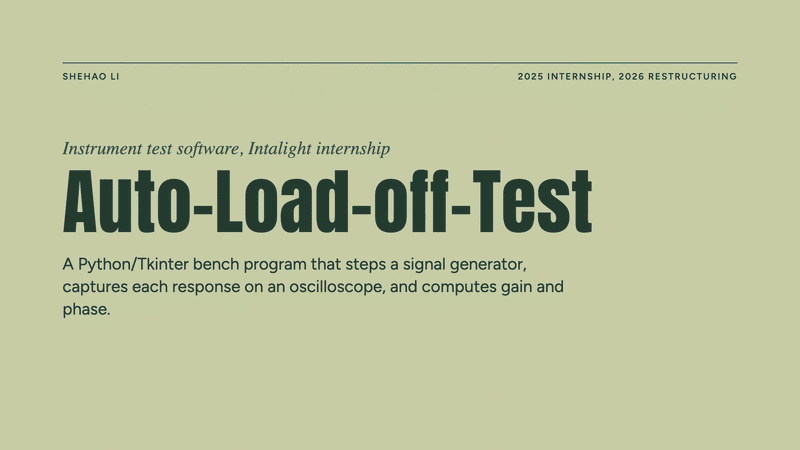
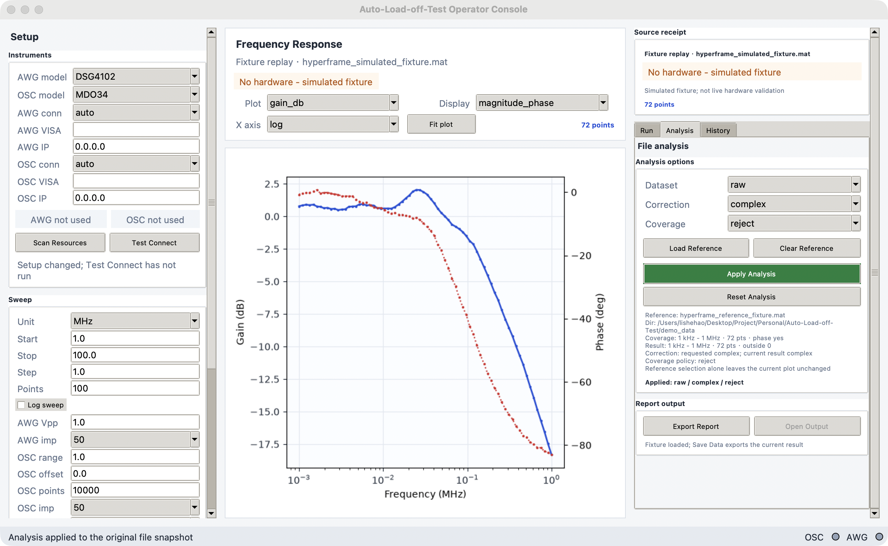
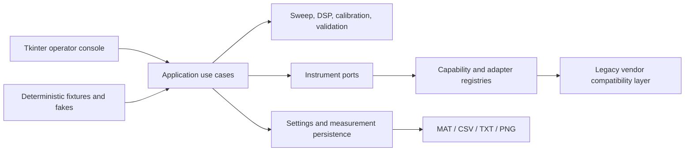

<h1 align="center">Auto-Load-off-Test</h1>

A Python/Tkinter bench program that steps a signal generator, captures each response on an oscilloscope, and computes gain and phase.

<p align="center">
  <a href="https://github.com/lishehao/auto-load-off-test/actions/workflows/ci.yml"></a>
  
  
</p>

<p align="center">
  <a href="#demo">Demo</a> &middot;
  <a href="#why">Why</a> &middot;
  <a href="#how-to-run">How to run</a> &middot;
  <a href="#design-and-results">Design and results</a> &middot;
  <a href="#limits">Limits</a> &middot;
  <a href="#who-wrote-what">Who wrote what</a> &middot;
  <a href="#license">License</a>
</p>

## Demo

[](https://lishehao.github.io/projects/auto-load-off-test/)

The loop above (no sound, no hardware) shows the real operator console replaying the simulated 72-point fixture, then the HTML report that `auto-load-off-test analyze` writes for the same fixture.

<p align="center">
  <a href="https://youtu.be/fYokRzNnm84"><strong>Watch the operator console demo on YouTube</strong></a>
</p>

The published walkthrough shows an earlier real Tkinter console revision replaying a deterministic 72-point
fixture, not a live acquisition. The [local MP4 fallback](docs/images/auto-load-off-test-point-replay-demo.mp4)
is retained for offline viewing. Both keep **No hardware - simulated fixture** visible.



The current main branch adds **Load Demo Fixture / Replay Fixture**, stop and restart of playback, explicit
**Apply / Reset Analysis**, and **Export Report**. These run through the same controller the application uses. The
[local acceptance record](docs/validation/desktop-workflows-2026-09-12.md) separates verified behavior from
unverified hardware and native file dialogs.

## Why

Intalight is an ophthalmic-imaging company in Shanghai. Before this program, its hardware team ran each
frequency-response measurement with Python scripts that were often edited by hand for that measurement. The 2025
program replaced those scripts with one desktop tool: set up the generator and oscilloscope, run the sweep, and save
gain and phase. The 2026 work on the main branch restructured that same program.

## How to run

Start from a fresh clone (Python 3.10 or newer, with Tkinter):

```bash
git clone https://github.com/lishehao/auto-load-off-test.git
cd auto-load-off-test
python3 -m venv .venv
source .venv/bin/activate
python -m pip install --upgrade pip
python -m pip install -e ".[dev]"
```

On Windows, activate the environment with `.venv\Scripts\activate` instead.

Analyze the bundled demo measurement without hardware, Tkinter or an instrument connection:

```bash
auto-load-off-test analyze demo_data/simulated_sweep_fixture.mat --output __data__/analysis-demo
```

Open `__data__/analysis-demo/report.html` to see the data, plot, processing notes and input hashes. The output
directory must not already exist. See the [offline analysis guide](docs/offline_analysis.md) for input formats,
reference correction and error behavior.

Launch the desktop UI:

```bash
python src/main.py
```

The installed `auto-load-off-test` command with no arguments also opens it. To try the workflow without
instruments, select **Load Demo Fixture**, then **Replay Fixture**. The [operator guide](docs/operator_guide.md)
covers setup, replay, live runs, correction and export.

Run the 168 hardware-free tests and the lint check:

```bash
PYTHONPATH=src python -m unittest discover -s tests
python -m ruff check src/app tests scripts
```

Settings, automatic saves and logs go under a per-user root (macOS `~/Library/Application Support/Auto-Load-off-Test`,
Windows `%APPDATA%/Auto-Load-off-Test`, Linux `$XDG_DATA_HOME/Auto-Load-off-Test` or
`~/.local/share/Auto-Load-off-Test`). `AUTO_LOAD_OFF_TEST_ROOT` overrides this root. The
[packaging guide](docs/packaging.md) covers the Windows one-folder build.

## Design and results

For each frequency point the program sets the generator, captures the response on the oscilloscope, and computes
gain and phase, optionally corrected against a reference curve.

**Read back, use the read value, warn.** Instruments can accept a setting yet silently do something else. For
example, some generators asked for a frequency above their limit stop at the limit without an error. The 2025
version therefore reads back key settings (oscilloscope range and offset, generator amplitude and frequency), uses
the values it read, and warns when one is outside a tolerance. The 2026 version still reads back generator frequency
and amplitude and warns on a mismatch, but no longer reads back the oscilloscope range and offset after setting them.

**Acquisition off the UI thread.** Acquisition runs on a worker thread with queues and stop events, so the window
stays responsive and a sweep can be stopped.

**Output.** Results export as MAT, TXT and CSV, with plots. The export formats and plots were adjusted from operator
feedback. In the 2026 version, exports do not silently replace existing output.

**2026 structure.** The main branch separates the operator UI, use cases, sweep and signal-processing logic,
persistence, and instrument adapters:



- Application code depends on [AWG/oscilloscope ports](src/app/application/ports/instruments.py). A
  [capability registry](src/app/domain/instrument_capabilities.py) holds model limits, and the
  [adapter registry](src/app/infrastructure/instruments/adapter_registry.py) picks production or fake adapters. The
  driver file [`equips.py`](src/equips.py) is kept as an isolated compatibility layer rather than rewritten without
  a physical test bench.
- [Boundary validation](src/app/domain/data_validation.py) rejects missing fields, length mismatches, non-finite
  gain, and non-positive, duplicate or unsorted frequencies. The
  [end-to-end workflow test](tests/test_hardware_free_workflow.py) rebuilds corrected gain and phase from raw and
  reference curves, exports MAT/CSV/TXT, and reloads them.
- The [offline analysis command](docs/offline_analysis.md) runs without Tkinter or PyVISA and writes data exports,
  a plot, an HTML report and a hashed JSON manifest.
- [GitHub Actions](.github/workflows/ci.yml) runs the tests on Linux, macOS and Windows, runs Ruff, and builds a
  Windows PyInstaller one-folder package with a [package smoke](src/app/demo/package_smoke.py) that records
  `live_hardware_used: false`.

Registered instrument paths:

| Role | Registered models |
| --- | --- |
| AWG | `DSG4102`, `DSG836` |
| Oscilloscope | `MDO34`, `MDO3024`, `DHO1202`, `DHO1204` |

These names describe registered software paths, not a current live-hardware compatibility certificate.

**Testing.** The company's test engineers tested the 2025 program on instruments before its engineers used it. The
2026 main branch adds 168 hardware-free tests.

Further documents:

| Topic | Document |
| --- | --- |
| Design decisions and tradeoffs | [Case Study](docs/case_study.md) |
| Layer boundaries and dependencies | [Architecture](docs/architecture.md) |
| Evidence levels and unsupported claims | [Validation Matrix](docs/validation_matrix.md) |
| Setup, replay, run, correction and export | [Operator Guide](docs/operator_guide.md) |
| Stop behavior and operator responsibilities | [Safety Notes](docs/safety.md) |
| Adding adapters, persistence or UI behavior | [Extending The Application](docs/extending.md) |
| Windows one-folder build and prerequisites | [Packaging](docs/packaging.md) |
| Deterministic fixture design and provenance | [Demo Fixture](docs/demo_fixture.md) / [Demo Data](demo_data/README.md) |

## Limits

> **Validation boundary:** automated tests and demonstration evidence are hardware-free. Production adapter paths are inspectable, but
> this repository does not claim current live AWG/oscilloscope, metrology, or production-safety validation.

The 2026 tests use pure logic, temporary files, deterministic arrays and fake instrument ports. They do not prove
instrument timing, acquisition fidelity, calibration uncertainty, real VISA enumeration, firmware compatibility,
electrical output-off latency or safe operation of a device under test. macOS is the UI acceptance target for the
current iteration; Windows UI validation is not implied by the cross-platform tests or the packaging check.

This is a local engineering tool, not a certified production test platform. Before any live run, an operator must
confirm the instrument model and address, probe attenuation, voltage and frequency limits, termination, coupling,
trigger behavior and device-under-test constraints. See the [validation matrix](docs/validation_matrix.md) and
[safety notes](docs/safety.md).

## Who wrote what

- **2025 version, tag [v0.1.0](https://github.com/lishehao/auto-load-off-test/tree/v0.1.0).** During my internship
  at Intalight (July to September 2025), I (Shehao Li) was the sole developer of this program. I wrote 3,100+ lines
  of it by hand, with only light code completion and no coding agent. Part of the instrument-driver file (`equips`)
  came from other people; the parts for the instruments listed above, the measurement logic and the UI are mine.
- **2026 version, the main branch.** A restructuring of the same program, written by a coding agent to my
  specification. It added the 168 hardware-free tests.

The code is open-sourced with the company's permission. Case study:
[lishehao.github.io/projects/auto-load-off-test](https://lishehao.github.io/projects/auto-load-off-test/).

## License

No license has been chosen yet.
